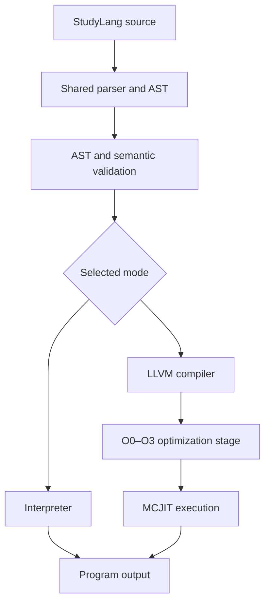

# StudyLang execution architecture

`main.py` selects the mode and delegates to the corresponding package runner.
Both paths use `Shared/grammar.lark`, `Shared/ast_nodes.py`,
`Shared/frontend.py`, `Shared/m6_ast_tool.py`, and `Shared/semantic.py`.
Shared runtime failures use `Shared.errors.StudyLangRuntimeError`.
`Shared.builtins` defines the array-query signatures used by semantic analysis
and the interpreter's predefined environment.

| Module | Responsibility |
| --- | --- |
| `Shared.frontend` | Load the adjacent grammar, handle indentation, and transform the parse tree |
| `Shared.ast_nodes` | AST dataclasses used by every stage |
| `Shared.m6_ast_tool` | Validate AST structure |
| `Shared.semantic` | Validate declarations, scope, types, and call arity |
| `Interpreter.run` | Parse, validate, and execute source through the interpreter |
| `Interpreter.interpreter` | Runtime values, parent-linked environments, and AST execution |
| `Compiler.run` | Parse source, compile it, and provide the compiler CLI |
| `Compiler.compiler` | Validate the AST and generate verified LLVM IR |
| `Compiler.optimizer` | Verify IR and optionally apply LLVM O1–O3 pipelines |
| `Compiler.jit` | Supply typed output callbacks and execute native code |

Interpreter mode calls `Interpreter.run.run`. Compiler mode calls
`Compiler.run.compile_source`, `Compiler.optimizer.optimize_ir`, and
`Compiler.jit.run_ir`. The public compiler API also validates input so direct
callers receive structural and semantic checks.

The shared files are imported by both packages. Single AST class identities
and semantic definitions prevent duplicate copies from drifting apart.
Both-mode integration tests verify these shared rules through the launcher.

The grammar is resolved relative to `Shared/frontend.py`, and numbered/default
examples are resolved relative to the project root. Explicit relative source
paths are resolved from the working directory. The package runners support
both `python3 -m Compiler.run`/`Interpreter.run` and direct script invocation.

The interpreter executes the full language. The compiler accepts the subset
and numeric bounds in [M9_EVIDENCE.md](M9_EVIDENCE.md#backend-limitations).
Its IR targets the host machine and calls output functions supplied by the
Python JIT runner. The runtime and compiler approaches retain the original
project goals of straightforward execution and inspectable code generation.

## Design rationale

- Simplicity guided the initial interpreter path, allowing small study programs
  to execute while the language was being developed.
- Debuggability favors a tree-walking interpreter whose values and execution
  order can be inspected directly.
- Semester scope guided the sequence from frontend and AST work to the
  interpreter, then LLVM code generation and integrated execution.

The LLVM path adds native execution and optimization at the cost of more
complex code generation and runtime support. Its documented subset keeps
that work manageable while the interpreter supports the full language.
